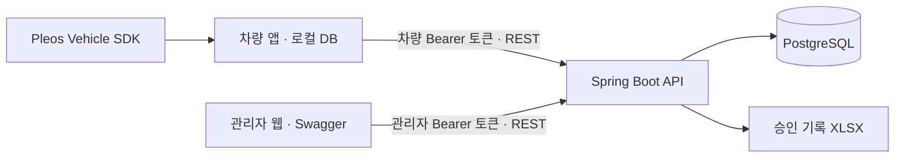
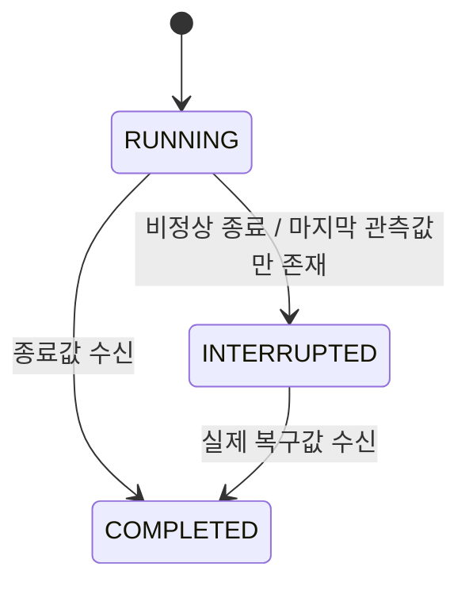
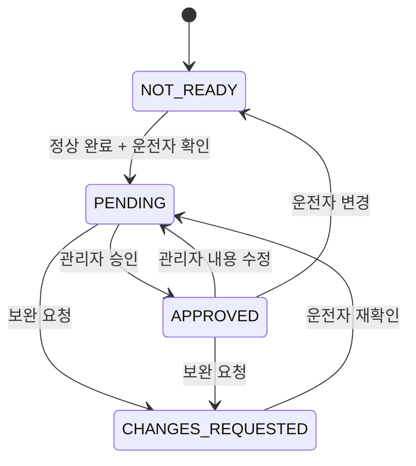

# 구조와 데이터 정책

Java 21 / Spring Boot 3.5, Spring Security, Spring JDBC, Flyway, PostgreSQL 17, Apache POI를 사용합니다. 서버에 Pleos SDK를 설치하지 않습니다. [공식 Vehicle SDK 문서](https://document.pleos.ai/en/docs/pleos-only/connect-sdk-pleos/Vehicle/intro)의 차량 앱이 수집한 자료를 HTTP로 받습니다.

## 구성

| 패키지 | 책임 |
|---|---|
| `auth` | 기업 가입, 관리자 인증, 직원 발급/비활성화, 설정 링크, 차량 페어링, 토큰 검증 |
| `fleet` | 차량·운전자·목적·거래처·동의 이력 |
| `trip` | 측정값 동기화, 상태 전이, 낙관적 버전 검사, 감사 기록, 검색·추천·공백 |
| `report` | 승인 자료의 통계와 XLSX. 반복 읽기 트랜잭션으로 출력 중 데이터 기준 유지 |
| `common` | 오류 응답, JDBC 결과 변환, OpenAPI |

## 데이터와 회사 격리

모든 업무 테이블은 `company_id`를 갖습니다. 인증 토큰에서 회사를 정하며 요청 본문으로 회사를 선택하지 않습니다. 회사에 속한 차량·운전자·목적·거래처를 연결할 때 `(company_id,id)` 복합 외래키와 회사 조건 조회를 함께 사용합니다. 타 회사의 ID는 404로 처리합니다. 차량 토큰은 자기 차량의 운행만 읽거나 변경할 수 있고 관리자 API를 호출할 수 없습니다.

`companies → admins / vehicles / drivers / clients / purposes → trips → trip_audit` 구조입니다. `credentials`는 관리자 또는 차량에 귀속되고 `consent_events`는 운전자와 동의를 보낸 차량을 기록합니다. 비활성화는 이력을 삭제하지 않습니다.

비밀번호는 BCrypt(비용 12), 토큰은 256비트 난수이며 DB에는 SHA-256 해시만 저장합니다. 인증은 `Authorization: Bearer` 헤더를 사용하고 쿠키 세션을 만들지 않습니다. 로그아웃/계정 비활성화/차량 재연결 시 DB의 해당 자격 증명을 폐기합니다. 비밀번호 설정 토큰은 일회성이며 재발급·사용 시 기존 링크를 폐기하고 비밀번호 변경 시 기존 관리자 세션도 폐기합니다.

비밀번호 설정 링크의 토큰은 URL fragment에 넣어 서버 접근 로그의 쿼리로 전송되지 않게 합니다. 설정 페이지는 외부 스크립트가 없고 토큰·로그인 정보를 브라우저 저장소에 저장하지 않습니다.

## 운행과 승인 상태

기록 상태와 승인 상태는 서로 다른 필드입니다.

서버에 처음 올라오는 상태가 COMPLETED 또는 INTERRUPTED여도 허용합니다. 앱이 오프라인에서 시작·종료한 기록도 수신하기 때문입니다. 완료 기록을 RUNNING으로 되돌릴 수 없습니다.

보완 요청은 원본 기록을 없애지 않고 현재 확인·승인 시각만 해제합니다. 최초 확인 시 `measurement_locked_at`을 설정하며 이후 확인 해제와 무관하게 동기화 원본을 보호합니다. V3 마이그레이션은 기존 확인 시각 또는 DRIVER_CONFIRM 감사 이력으로 잠금을 복원합니다. 관리자 편집은 분류·운전자·목적·거래처·비고를 대상으로 하며 사유가 필수입니다. 기존 운전자를 바꾸거나 미확인 분류로 돌리면 운전자 확인을 다시 받아야 합니다. 차량도 종료된 미승인 기록을 사유와 함께 편집할 수 있고 재확인이 필요합니다. 원본 계기판 값은 관리자 편집 대상이 아닙니다.

### 동시성

- 동기화는 차량 행 잠금으로 같은 UUID의 최초 동시 업로드를 직렬화합니다.
- 기기 `sourceRevision`과 서버 `serverVersion`을 함께 검사합니다. 동일 요청 재전송은 새 이력을 만들지 않습니다.
- 관리자 편집·확인·승인은 운행 행 잠금과 `expectedVersion`으로 변경 손실을 방지합니다.
- 승인은 먼저 차량 행을 잠그고 같은 차량의 승인된 운행과 시간 또는 계기판 구간이 겹치는지 확인합니다. 동시에 겹친 운행 두 건을 승인할 수 없습니다.
- 상태 변경과 감사 이력 기록은 한 트랜잭션으로 커밋합니다. 감사 이력은 API로 수정·삭제하지 않습니다.

### 원본과 불확실성

계기판 값은 km, `numeric(14,3)`입니다. 단위를 추측해 환산하지 않습니다. 시각은 UTC로 저장하고 PostgreSQL 정밀도에 맞춰 최대 소수점 6자리까지 받습니다. 시작/종료/관측 시각 순서를 검사하고 서버 현재보다 5분 이상 미래인 값은 거절합니다.

계기판 누락, 역전, 시작 0, 미완료, 시간이 흐르지 않았는데 양의 거리가 생긴 경우에는 품질 문제를 표시합니다. 확인 전의 null/0 시작값은 실제 관측값으로 갱신할 수 있고 이전 값은 감사 이력에 남습니다. 수집 출처와 오류를 보존하며 마지막 관측과 시작·종료 계기판의 역전도 품질 문제로 표시합니다. 마지막 관측 생략은 기존 값을 지우지 않고 감소·시각 역행은 거절합니다. 음수 거리를 0으로 바꾸거나 마지막 관측값을 종료값으로 확정하지 않습니다. 미완료 `observedDistanceKm`는 최종 거리와 별도로 다룹니다.

운전자·목적·거래처의 표시값은 확인 시 스냅샷으로 저장합니다. 목록 항목을 비활성화하거나 이름을 바꾸어도 과거 기록의 값은 유지됩니다. 기존 선택 항목을 유지한 편집은 가능하지만 새 기록에서는 비활성 항목을 선택할 수 없습니다.

## 검증 환경

`autolog`은 개발 DB, `autolog_test`는 통합 테스트 전용입니다. Flyway가 빈 DB부터 스키마를 구성하며 테스트 시작 시 DB 이름을 검사한 후 업무 테이블만 초기화합니다. CI도 PostgreSQL 17 서비스에서 같은 `clean verify`를 실행합니다. DB 테스트는 데이터 초기화 때문에 병렬 클래스 실행을 하지 않습니다. 동시성 검증이 필요한 시나리오만 한 테스트 안에서 병렬 HTTP 요청을 만듭니다.
